<a href="https://temmy762.github.io/start/">
  
</a>

  
  
  
  
  


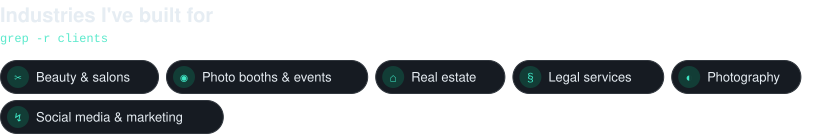

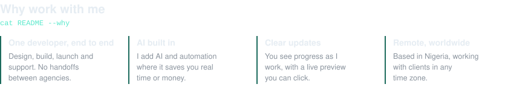


### Featured projects

  <a href="https://github.com/temmy762/barbing-saas"></a>
  <a href="https://github.com/temmy762/solvatree"></a>
  <a href="https://github.com/temmy762/whatsapp-bridge"></a>
  <a href="https://github.com/temmy762/jarvis"></a>
  <a href="https://github.com/temmy762/movo-mobile"></a>
  <a href="https://github.com/temmy762/realestate"></a>



### GitHub activity

  
  

### A year of coding

Each square is a day I wrote code. Brighter green means more work that day. The snake redraws itself every day.

<picture>
  <source media="(prefers-color-scheme: dark)" srcset="https://raw.githubusercontent.com/temmy762/temmy762/output/github-snake-dark.svg" />
  <source media="(prefers-color-scheme: light)" srcset="https://raw.githubusercontent.com/temmy762/temmy762/output/github-snake.svg" />
  
</picture>

### GitHub achievements

### Questions clients ask

<b>What kind of projects do you take on?</b>

 
Websites, web platforms, mobile apps, AI assistants and business automations. Small fixes and full products are both welcome.

<b>I'm not technical. Can I still work with you?</b>

 
Yes. I explain everything in plain language, and you only need to know what you want your business to do. I handle the technical side.

<b>How long does a project take?</b>

 
It depends on the size. You get a clear timeline in the planning step, before any work or payment starts.

<b>Do you offer support after launch?</b>

 
Yes. I stay available to fix issues, make updates and add new features as your business grows.

 

<a href="https://temmy762.github.io/start/">
  
</a>

  
  <a href="https://www.upwork.com/freelancers/bankoledanieloriyomi">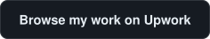</a>
  

Prefer email? Write to **[temmylayo817@gmail.com](mailto:temmylayo817@gmail.com?subject=New%20project%20enquiry)**.

<code>// build · automate · ship · repeat</code>

